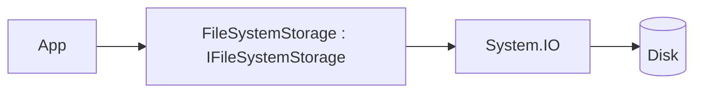

# Feature: File System Provider (`ManagedCode.Storage.FileSystem`)

## Purpose

Implement `IStorage` on top of the local file system so you can use the same abstraction in production code, local development, and tests:

- local development
- on-prem/hybrid deployments
- tests and demos

## Main Flows



## Components

- `Storages/ManagedCode.Storage.FileSystem/FileSystemStorage.cs`
- `Storages/ManagedCode.Storage.FileSystem/FileSystemStorageProvider.cs`
- DI:
  - `Storages/ManagedCode.Storage.FileSystem/Extensions/ServiceCollectionExtensions.cs`
  - `Storages/ManagedCode.Storage.FileSystem/Extensions/StorageFactoryExtensions.cs`
- Options:
  - `Storages/ManagedCode.Storage.FileSystem/Options/FileSystemStorageOptions.cs`

## DI Wiring

```bash
dotnet add package ManagedCode.Storage.FileSystem
```

```csharp
using ManagedCode.Storage.FileSystem.Extensions;

builder.Services.AddFileSystemStorageAsDefault(options =>
{
    options.BaseFolder = Path.Combine(builder.Environment.ContentRootPath, "storage");
});
```

## Current Behavior

- `BaseFolder` acts as the container root.
- Supports directory creation when `CreateContainerIfNotExists = true`.
- Uploads use a 256 KiB copy buffer and leave the source stream under caller ownership.
- Directory listing and deletion accept paths relative to `BaseFolder`. Use `RemoveContainerAsync` to delete the container root.
- File and directory operations reject paths that traverse symbolic links or reparse points below the configured root. Recursive listings skip those entries.
- A legal hold in the provider instance blocks overwrite and deletion of the file. Deleting a directory or the container also fails while it contains a held file.

## Tests

- `Tests/ManagedCode.Storage.Tests/Storages/FileSystem/FileSystemUploadTests.cs`
- `Tests/ManagedCode.Storage.Tests/Storages/FileSystem/FileSystemDownloadTests.cs`
- `Tests/ManagedCode.Storage.Tests/Storages/FileSystem/FileSystemBlobTests.cs`
- `Tests/ManagedCode.Storage.Tests/Storages/FileSystem/FileSystemContainerTests.cs`
- `Tests/ManagedCode.Storage.Tests/Storages/FileSystem/FileSystemSecurityTests.cs`
