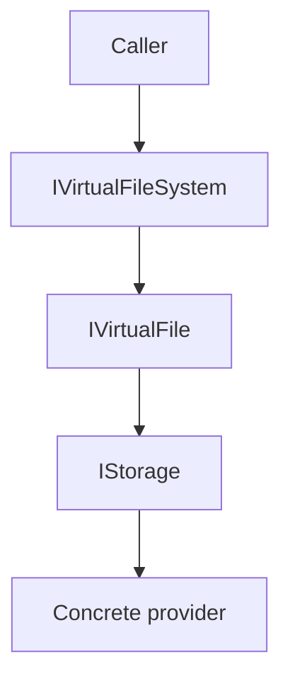

# Feature: Virtual File System (`ManagedCode.Storage.VirtualFileSystem`)

## Purpose

Expose a higher-level “virtual file system” API on top of `IStorage`:

- file/directory objects (`IVirtualFile`, `IVirtualDirectory`)
- metadata caching and convenience operations (exists, read/write streams, range reads)
- predictable behaviour across providers by routing everything through the same `IStorage` surface

This is *not* a separate cloud provider. It is an abstraction layer that sits above any configured `IStorage`.

## Main Flows

### File operations

Metadata reads return null or empty metadata only for a real provider 404 or absent metadata fields. Cancellation propagates, including cancellation returned inside a portable provider Result. Other provider failures throw with their original Problem instead of becoming a missing file; failed reads do not populate the metadata cache. Reusing the handle after cancellation can read the retained file. Real-provider regressions cover cancelled reads, rejected reads, write/delete/missing lookup and read recovery.

After a write or deletion through the backing provider, call `IVirtualFile.RefreshAsync` on an existing file handle. It refreshes metadata and invalidates cached existence, including a cached miss before a multipart commit. The next existence check and read observe the committed object.

Writes and deletes through the VFS invalidate shared metadata for existing handles. Reads resolve metadata through that cache or the provider. The default metadata manager builds each refreshed snapshot from one provider lookup.

`ReadRangeAsync` returns the available bytes when a range reaches the end of a file. Seekable reads cap allocation at the remaining length. Large ranges on forward-only streams use a pooled transfer buffer and grow the result as bytes arrive.



### Directory operations

- Directory listing is implemented by prefix-listing blob metadata via `IStorage.GetBlobMetadataListAsync(...)`.
- Search patterns match names with `*` for zero or more characters and `?` for one character. Matching uses ordinal comparison and ignores case by default.
- A directory move rejects overlapping source and destination paths. With overwrite disabled, a destination file conflict leaves the source files in place. The move removes only the source files it copied, and reports an error if a source cannot be removed. Copies completed before a failure can remain at the destination.
- A copy stages each file and sends its bytes and selected metadata in the same upload. If reading that file fails, an existing destination retains its content. A directory copy scans for progress totals only when a progress reporter is supplied.

### Immutable content and metadata

`IVirtualFileSystem.WriteBytesIfAbsentOrSameAsync` stores the provided portable
object metadata alongside the exact immutable bytes. `IVirtualFile.GetMetadataAsync`
returns those user fields from both fresh handles and handles which previously
cached a missing file. This includes ASCII and Unicode values. Legacy user fields
stored under the metadata manager's VFS prefix are exposed with that prefix
removed. Only the overlay's reserved version, timestamp, attribute and internal
custom-state fields are filtered; a user field merely containing those names is
preserved. A matching retry retains the existing object and ETag.

`IVirtualFileSystem.WriteIfAbsentOrSameAsync` is the streaming form for large
immutable payloads. The caller passes the content stream and its declared length;
the overlay delegates to `VerifiedObjectUpload.WriteIfAbsentOrSameAsync`, which
stages the stream in bounded parts through SHA-256 and commits it atomically. It
returns the digest, ETag and whether an identical retry reused the existing
revision. Different content or placement metadata keeps the provider conflict, and
a stream shorter or longer than the declared length fails before commit. Both
immutable writes invalidate the cached existence and metadata entries for the
path. The streaming form requires a provider with staged multipart writes.

## Components

Key files:

- `ManagedCode.Storage.VirtualFileSystem/Implementations/VirtualFileSystem.cs` — VFS entry point; wraps `IStorage`
- `ManagedCode.Storage.VirtualFileSystem/Implementations/VirtualFile.cs` — file operations (`OpenReadAsync`, `OpenWriteAsync`, metadata)
- `ManagedCode.Storage.VirtualFileSystem/Implementations/VirtualDirectory.cs` — directory operations (list, delete)
- `ManagedCode.Storage.VirtualFileSystem/Core/VfsPath.cs` — path handling
- `ManagedCode.Storage.VirtualFileSystem/Options/VfsOptions.cs` — caching + defaults
- `ManagedCode.Storage.VirtualFileSystem/Streaming/VfsWriteStream.cs` — buffered write stream that uploads on dispose

## DI Wiring

```bash
dotnet add package ManagedCode.Storage.VirtualFileSystem
```

VFS requires an `IStorage` to be registered first (any provider works). Then you add the overlay:

```csharp
using ManagedCode.Storage.FileSystem.Extensions;
using ManagedCode.Storage.VirtualFileSystem.Core;
using ManagedCode.Storage.VirtualFileSystem.Extensions;

builder.Services.AddFileSystemStorageAsDefault(options =>
{
    options.BaseFolder = Path.Combine(builder.Environment.ContentRootPath, "storage");
});

builder.Services.AddVirtualFileSystem(options =>
{
    options.DefaultContainer = "vfs";
    options.EnableCache = true;
});

public sealed class MyService(IVirtualFileSystem vfs)
{
    public async Task DemoAsync(CancellationToken ct)
    {
        var file = await vfs.GetFileAsync("docs/readme.txt", ct);
        await file.WriteAllTextAsync("hello", cancellationToken: ct);

        var text = await file.ReadAllTextAsync(cancellationToken: ct);
    }
}
```

## Current Behavior

- Existence checks and metadata can be cached in `IMemoryCache` when enabled via `VfsOptions`. Each VFS instance has its own cache keys, including when several mounts share a container name. Successful writes and deletions invalidate file entries and cached existence for ancestor directories.
- File existence checks use `IStorage.ExistsAsync(...)`; they do not fetch blob metadata or turn an expected missing file into provider exception telemetry.
- `OpenWriteAsync` returns a file-backed stream that uploads on disposal. A failed or cancelled write discards its buffered content. Disposal checks the opening cancellation token before starting the provider upload.
- Concurrency checks can be enforced via `WriteOptions.ExpectedETag` where supported by the underlying provider.

## Tests

- `Tests/ManagedCode.Storage.Tests/VirtualFileSystem/VirtualFileSystemTests.cs`
- `Tests/ManagedCode.Storage.Tests/VirtualFileSystem/VirtualFileSystemManagerTests.cs`
- `Tests/ManagedCode.Storage.Tests/VirtualFileSystem/VfsImmutableMetadataTests.cs`
- `Tests/ManagedCode.Storage.Tests/VirtualFileSystem/VfsImmutableStreamWriteTests.cs`
- `Tests/ManagedCode.Storage.Tests/VirtualFileSystem/*VirtualFileSystemFixture.cs` (cross-provider fixtures)

## References

- `docs/Testing/strategy.md`
